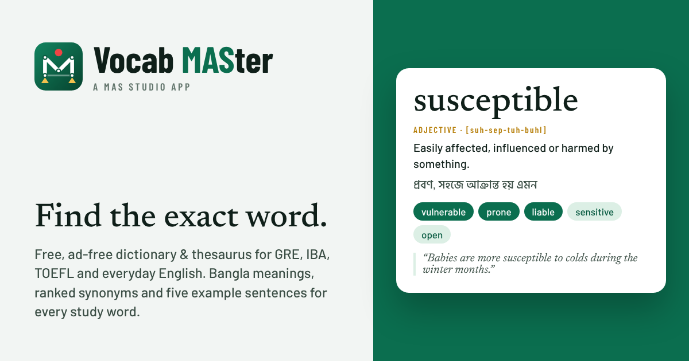

# Vocab MASter

**A free, ad-free dictionary and thesaurus for GRE, IBA, TOEFL and everyday English.** A [MAS Studio](https://github.com/Al-Shahriar-12) app by MD Al Shahriar (BSc. Civil Engineering, BUET).

Live site: https://al-shahriar-12.github.io/vocab-master/

## What's inside

- **6,483 full entries.** Each one has a learner's definition, a Bangla meaning (বাংলা অর্থ), synonyms ranked *Strongest / Strong / Weak*, antonyms, related words, a usage pattern, the pronunciation (respelling and IPA, with audio from your device's voice) and **five everyday example sentences**.
- **14,116 more thesaurus entries** from WordNet, so almost every synonym you tap opens a page.
- **11 study lists**, built from the source files:

  | List | Words |
  |---|---|
  | GRE High Frequency (Barron's 333 + GRE Hit Parade) | 478 |
  | GRE Complete | 1,147 |
  | Barron's 333 | 332 |
  | GRE 500 Essential | 502 |
  | GRE 500 Advanced | 502 |
  | GRE Hit Parade (Word Smart) | 201 |
  | Word Smart I | 859 |
  | Word Smart II | 828 |
  | IBA Admission (BBA 2005–2020, MBA 2007–2018, filter by year) | 1,053 |
  | TOEFL Academic Word List (sublists 1–10) | 570 |
  | Oxford 3000 Everyday (words and phrasal verbs) | 3,488 |

- **Import your own list** (for example a GregMat group or a class handout) by pasting the words.
- **Study tools:** flashcards with spaced repetition, a 10-question quiz (meaning, synonym, Bangla and fill-in-the-blank), a timed Match game, Spin the Wheel, Word of the Day with a two-week archive, saved words and history.
- **Entry layout like Thesaurus.com, with no ads:** section tabs for Synonyms & Antonyms, Examples, Related Words, Lists and Definitions, sense cards, and an animated synonym map.
- **Works offline** after the first visit, installs like an app on phones and computers, and has light and dark themes.

## Publish on GitHub Pages

1. **Create the repository.** On github.com, click **New**. Name it `vocab-master`, choose **Public**, leave *Add a README* unticked, and click **Create repository**.
   *Updating an existing `vocab-master` repo instead?* Open it, click **Add file → Upload files**, and go to step 3. Files with the same name are replaced.
2. On the new, empty repository page, click the link **uploading an existing file**.
3. **Unzip** `vocab-master-v2.0.0.zip`. Open the `vocab-master` folder, press **Ctrl+A** (Cmd+A on Mac) to select all 76 files, and drag them onto the upload page. Use Chrome or Edge, and drag from the freshly unzipped folder. All files sit at the top level, so nothing gets lost in sub-folders.
4. Wait until every file shows in the list, type a commit message such as `Vocab MASter v2.0.0`, and click **Commit changes**.
5. **Turn on Pages.** Go to **Settings → Pages**. Under *Build and deployment*, set **Source: Deploy from a branch**, **Branch: `main`**, folder **`/ (root)`**, and click **Save**.
6. **Open the site** after 1–2 minutes: https://al-shahriar-12.github.io/vocab-master/ . The **Actions** tab shows a green tick when the deploy is done.
7. **Check it:** search *susceptible*, open **Lists → IBA Admission**, then **About**. On a phone, use **Add to Home screen** to install it.
8. *Optional:* add the site in Google Search Console and submit `sitemap.xml`, and pin the repository on your GitHub profile.

**Updating later:** upload the changed files the same way and commit. Each release raises the version in `sw.js`, so installed copies pick up the new version the next time they open online.

## Files

| File | What it is |
|---|---|
| `index.html` | The whole app: HTML, CSS and JavaScript in one file |
| `words-index.js` | Search index: every headword, part of speech, short definition, Bangla meaning and list tags |
| `words-01.js` … `words-44.js` | The full entries, loaded only when needed |
| `sw.js`, `manifest.webmanifest` | Offline support and app install |
| `*.woff2`, `OFL.txt` | Self-hosted fonts and their licence, so the look is the same offline |
| `author.jpg`, `author-cover.jpg` | Photos for the About page |
| `logo.svg`, `icon-*.png`, `apple-touch-icon.png`, `og-image.png` | Logo, app icons and the link-preview image |
| `verify.js` | Data check. Run `node verify.js`; it confirms every full entry has a definition, a Bangla meaning and five example sentences |
| `sitemap.xml`, `robots.txt`, `.nojekyll` | Search engines and GitHub Pages settings |
| `LICENSE`, `DATA-LICENSES.md`, `CITATION.cff`, `CHANGELOG.md` | Licences, data sources, citation and release notes |

## Credits

Word lists contribute headwords only. Definitions, Bangla meanings, ranked synonyms and example sentences were written for Vocab MASter. Extra senses and related words come from WordNet 3.1 (Princeton University); pronunciations are generated from the CMU Pronouncing Dictionary. Details are in `DATA-LICENSES.md`.

## More from MAS Studio

- [Flexure MAS](https://al-shahriar-12.github.io/flexure-mas/): beam analysis
- [Frame MAS](https://al-shahriar-12.github.io/frame-mas/): 2D frame and truss analysis
- [BNBC Frame MAS](https://al-shahriar-12.github.io/bnbc-frame-mas/): BNBC 2020 frame design assistant
- [Beam-Frame MAS](https://al-shahriar-12.github.io/beam-frame-mas/): beams and frames in one app
- [Chess MAS](https://al-shahriar-12.github.io/chess-mas/): a break from solving problems

*If this app helped you, please remember its author in your duas.*
